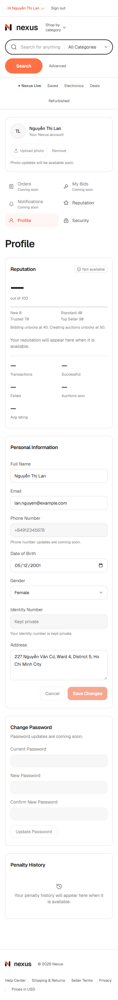
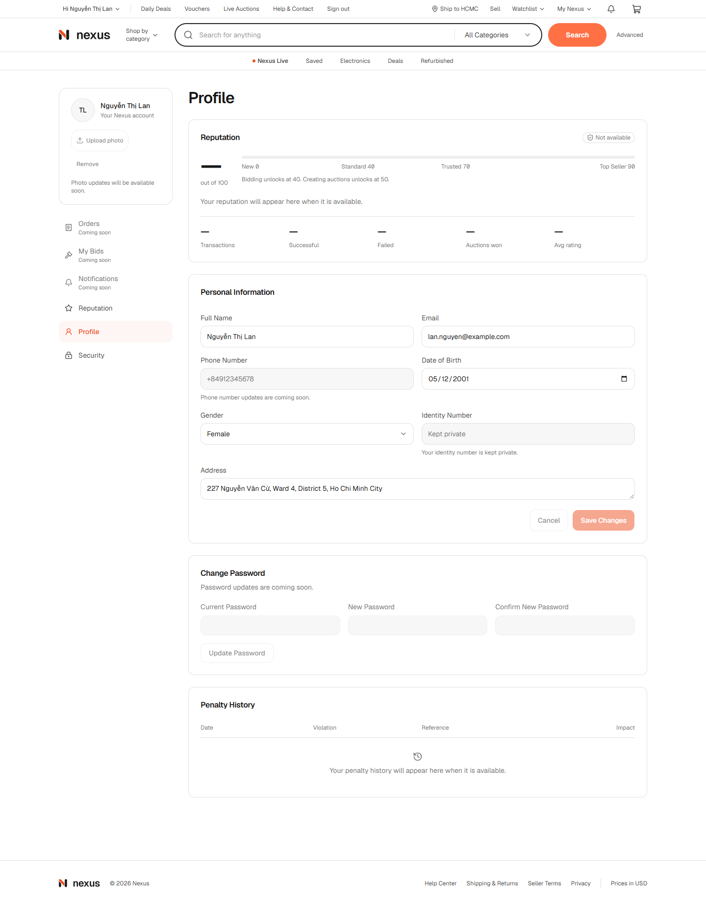

# Profile page

Signed-in users can open `/profile`, read their current profile, edit supported
personal details, and save without leaving the page. A successful save updates
the form, account avatar initials/name, and header name from the same shared user
query. This change is frontend only.

## Structure and navigation

- `app/(account)/profile/page.tsx` provides the route and page metadata.
- `features/ProfilePage.tsx` composes four separate main cards:
  `ReputationCard`, `PersonalInformationCard`, `ChangePasswordCard`, and
  `PenaltyHistoryCard`.
- The cards, sidebar, footer, avatar, and Skeleton live in
  `components/`. The feature files compose the page and
  coordinate its data; form validation lives in `features/profileSchema.ts`.
- `AvatarCard` is a separate sidebar card using the shadcn Avatar and its initials
  fallback. The sidebar and page display shadcn Skeleton components while loading.
- The UI uses Tailwind CSS and shadcn Card, Button, Input, Textarea, Select, Label,
  Avatar, and Skeleton components.
- `route.ts` centralizes routes and navigation data. The header name and
  “My Nexus” link to `/profile`; the sidebar renders `ACCOUNT_NAVIGATION.map()`.
  Reputation and Security link to their card anchors. Unimplemented destinations
  are visibly pending. Repeated fields, gender options, reputation thresholds,
  statistics, and table headings also render from data with `.map()`.

`ProfilePage` renders `ProfileSkeleton` while its client-side `/me` request is
pending. There is no route-level `loading.tsx`: that convention creates a Suspense
fallback for route navigation/streaming and does not track a request started by
`useEffect`.

Entry revalidation follows session readiness rather than token value. A normal
renewal therefore keeps the mounted form and its unsaved fields intact instead
of launching an unrelated profile read that could replace it with an error UI.

## API and state

`features/ProfilePage.tsx` revalidates `GET /api/v1/users/me` on entry through the
shared auth query. The provider owns retry and save operations using the active
session's scoped request context. `service/accountService.ts` allowlists the body and
sends `PUT /api/v1/users/me` with bearer authentication; the configured API base
URL comes from the existing environment configuration.

Sign-in uses the existing Keycloak OIDC/PKCE flow and callback. Application
responses follow the delivered `{code,message,data}` envelope. The shared
`configs/api.ts` boundary validates that envelope before auth/profile services
validate the nested `UserResponse`; bare and malformed payloads are rejected.
Request types reuse the generated `UpdateProfile` schema.

On page load the provider first exposes `restoring` while it checks the existing
Keycloak SSO session through the silent callback. A successful check loads the
profile before exposing authenticated controls; missing SSO settles to anonymous.
The shared token coordinator renews credentials in memory and permits one replay
of a protected 401 request. Normal token rotation preserves the profile cache and
session generation. See [session restore](features/session-restore.md).

The form submits only changed fields supported by the backend DTO. The service
allowlists those fields and validates the returned `UserResponse` before updating
the shared query. An earlier GET is cancelled before the saved response enters
the cache, and results from an ended session cannot populate a later session.
Logout, renewal failure and provider unmount abort registered profile saves.
The save workflow checks its originating session before returning feedback or
publishing data; late results cannot restore a cleared or replaced account.
Cancel restores the latest saved values. A failed save preserves edits; a failed
load offers a retry.

The types match the current Java `UserResponse` and `UpdateProfileRequest`:

| Field | GET/PUT response | Editable through current PUT |
| --- | --- | --- |
| `id` | UUID string | No |
| `fullName` | string | Yes; trimmed, 1–150 characters |
| `email` | string | Yes; trimmed, lowercase, valid email, 1–255 characters |
| `phone` | string | No; read-only in the form |
| `gender` | `MALE \| FEMALE \| OTHER \| null` | Yes; one of the three enum values |
| `address` | string or null | Yes; trimmed |
| `dateOfBirth` | `YYYY-MM-DD` or null | Yes; valid date, not in the future |
| `roles` | string array of backend-defined role codes | No |
| `status` | `ACTIVE \| LOCKED \| DELETED` | No |
| `createdAt` | ISO offset date-time string | No |

Omitted or null update fields retain their backend values. The form prevents
clearing an existing birth date because the current API cannot clear it.
`identityNumber` is stored in the backend entity but omitted from `UserResponse`;
the UI shows “Kept private” without inventing or exposing a value.

Backend validation errors use Problem Details with
`errors: [{ field, code, detail }]`. The API client normalizes `detail` into form messages;
the form displays each known field's message next to its input and connects it
with `aria-describedby`. Duplicate-email 409 errors map to the email field.
Missing sessions redirect to `/sign-in` after restoration settles. A final 401
during save clears local authentication after the shared renewal/replay policy;
it does not implicitly trigger a remote logout redirect. Browser refresh can
restore the account through Keycloak SSO without persisting access, refresh or
ID tokens. Explicit logout prevents silent restoration until the next deliberate
sign-in. Deployed cookie/frame policy can prevent silent restoration; the
profile page does not provide a separate session protocol.

## Backend dependencies

The current PUT intentionally ignores `phone`; it has no phone field or phone
validation in `UpdateProfileRequest`. Phone remains read-only in this FE-only
scope. Supporting real phone changes and a real backend phone 400 response
requires a future backend contract change.

`PENDING_ACCOUNT_ENDPOINTS` in `service/accountService.ts` records these proposed paths:

| Feature | Proposed endpoint, pending backend confirmation | Current UI |
| --- | --- | --- |
| Avatar | `/api/v1/users/me/avatar` | Initials avatar; photo actions disabled |
| Password | `/api/v1/users/me/password` | Password fields and update action disabled |
| Reputation | `/api/v1/users/me/reputation` | Unavailable score/statistics shown as `—` |
| Penalties | `/api/v1/users/me/penalties` | Pending empty state |

These constants do not trigger requests. Their methods and DTOs still need
backend agreement. The UI does not show fabricated scores, trust levels,
transaction statistics, or penalties.

## Acceptance evidence for the merge request

| Requirement | Evidence / status |
| --- | --- |
| Profile populated from GET on entry | Browser test verifies authenticated GET and existing values in the form. |
| Save updates values and header name | Browser test checks partial PUT body, returned form values, and header name. |
| Field-level 400 errors | Error mapping associates an injected phone 400 with the phone input. This validates FE handling only; the current BE cannot produce that phone validation flow. |
| Edit phone | Deferred by the agreed FE-only scope; phone is read-only and excluded from PUT. |
| No session | Browser tests verify sign-in redirect and save-time 401 handling. |
| Loading, failure, and cancellation | Skeleton, load retry, preserved edits after save failure, and Cancel are covered. |
| 375×812 layout | Browser assertions check document width and visible text clipping; mobile screenshot attached below. |

The [profile verification report](profile-verification.md) records checks for the
current merge and historical results. `npm run test:profile` runs the real Next.js
frontend against local Postman stand-ins for Keycloak and the profile gateway.
The historical password-login backend check predates the Keycloak migration and
does not establish current live integration.

The screenshots use simulation data to demonstrate the layout:

