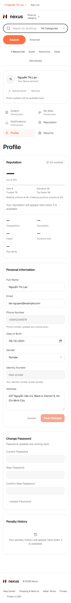
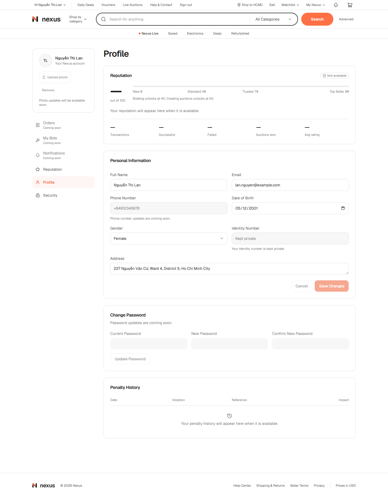

# Profile verification

## Session restore integration — 2026-11-05

Source `6357abb5` merges `origin/develop` at `1dd23dd3` in an isolated worktree.
The merged provider retains guarded profile mutations and their abort registry
while adopting the incoming token coordinator, restore lifecycle and bounded
401 replay. It checks the save's originating session generation, cancels older
profile reads before committing saved data and aborts pending saves when the
session ends, including renewal failure. Successful token rotation preserves
the same profile cache; a page reload attempts silent Keycloak restoration
before the profile UI decides whether sign-in is required.

Current executed checks:

- Exported source baseline `6357abb5`: 99/99 unit tests passed.
- Merged unit/transport suite: 138/138 passed.
- Generated DTO drift check and fresh-route typecheck passed.
- Lint passed.
- Dedicated OIDC/guest/session browser suite passed 24/24 in 1.3 minutes using
  app port 3151, simulation port 3961 and `.next-oidc-profile-final` output.
- Profile browser suite passed 10/10 in 39.0 seconds using app port 3153 and
  simulation port 3963; temporary port substitutions were restored afterwards.
- Main browser suite passed 31/31 in 1.3 minutes using app/simulation/catalog
  ports 3152/3962/3964 and `.next-catalog-profile-final`; temporary substitutions
  were restored afterwards. The three suites total 65 passed browser scenarios.
- `NEXUS_TEST_DIST_DIR=.next-verify-build npm run build` passed with exit code
  zero: production compilation, TypeScript and all 13 page generations.
  `/auth/silent` is present; temporary auth-smoke/session-probe routes are absent.

The Profile page now revalidates when the session becomes ready, preserving
dirty form fields across normal token rotation. The profile fixture validates
the issued token's actual expiry under the controlled clock and serializes its
request history. Browser assertions passed for proactive renewal preserving
dirty fields with no extra profile GET, then saving through the renewed token.
A persistent PUT 401 triggered exactly two PUTs and one renewal, no save and
no remote logout. The controlled clock is resumed before the final save so
TanStack can deliver its queued state notifications; an earlier paused-clock
attempt had already returned the correct PUT 200 data but held that UI update.

The auth simulation log recorded one listening event and 447 requests, including
token POST 200 (27)/400 (2), profile GET 200 (20)/401 (2)/503 (2), merge POST
200 (4)/503 (2), and protected GET 200 (18)/401 (8). These are local fixture
outcomes; the historical five-minute wall-clock scenario was not rerun here.

The profile log was inspected before the following general runner cleaned the
ignored output: one listening event and 191 requests, with token POST 200 (11),
profile GET 200 (26)/401 (1)/503 (2), and profile PUT 200 (3)/400 (1)/401 (2)/503
(1). This is current stand-in evidence; no live profile save was performed.

The final main-run log contains one listening event and 155 Keycloak requests,
including 15 successful token POSTs and three logout 302 responses. Its
application API calls use explicit browser HTTP fixtures. This log cannot
re-establish the earlier auth/profile run counters after runner cleanup.

Initial production-build attempts completed compilation/types/page generation
and then stopped at the installed Next.js security reminder. The final unchanged
retry passed; no framework upgrade or security-check bypass is included.
The checks in older sections below apply to their named revisions and are
preserved separately from this merge's results.
The [session restore guide](features/session-restore.md)
and [profile simulation context](../postman/simulations/profile.context.yaml)
describe the current lifecycle and preserved historical evidence.

## Develop integration — 2026-11-05

Merged develop at `0d0a36a4` into the profile branch. The profile feature,
components, schema and types use the flat frontend structure. Profile requests
use the single shared HTTP boundary and the current Keycloak session. The
provider updates the shared profile cache after a successful save and rejects
responses from an ended session.

Verification against this integration:

- Type generation and generated DTO drift check passed.
- Lint and regenerated-route typecheck passed.
- Unit/transport suite passed 78/78, including five profile regression tests.
- Catalog/cart/auth acceptance browser suite passed 30/30.
- Dedicated OIDC browser suite passed 11/11.
- Production build passed after the initial security reminder was acknowledged by retry.
- Profile browser suite passed 9/9 against the real Next frontend and local
  Postman profile/Keycloak stand-ins, covering PKCE sign-in, authenticated GET,
  partial PUT, shared header updates, validation, Cancel, loading, retry,
  expiry and the 375×812 layout.

The installed Next.js 16.4.0 emitted its existing security upgrade reminder
on first startup for isolated test output; retrying allowed verification to
continue. Dependency upgrades are a separate change from this conflict merge.

The simulation log confirmed eight provider token exchanges (200), 23 profile
GETs (200), two GET failures (503), two successful PUTs, and PUT 400/401/503
failures. No application password-login API call occurred. These results
establish behavior against local stand-ins; the historical live backend result
below predates the Keycloak migration and is not current integration evidence.

## Historical response-contract verification — 2026-11-03

The review finding was reproduced: the old API client passed the entire
`{code, message, data}` success envelope to the login/profile DTO guards.
The client now extracts `data` and normalizes current backend validation
`errors: [{field, code, detail}]` into form messages. Unit and browser fixtures
model the backend source on `origin/develop` at `6e92bbac`.

Verification on the profile branch with these changes:

- `npm run test:auth`: 41/41 tests passed, including malformed enveloped DTOs,
  register/login/GET/PUT envelopes, current 400 errors, and legacy payloads.
- `npm run test:profile`: 9/9 browser tests passed against the local Postman
  simulation. Login, profile GET, and successful PUT explicitly assert envelopes;
  changed names update the form and header. The 400 case uses `detail`.
- Simulation request events confirmed 8 successful login calls, 23 successful
  profile GETs, 2 successful PUTs, and the exercised 400/401/503 failures.
- `npm run lint` and `npm run build` passed.
- Existing auth browser acceptance passed 14/14 session, Bearer, storage/cache,
  race-condition, expiry, and retry checks with no browser errors.
- The 375×812 browser check found no horizontal overflow or clipped layout text.

These results exercise the real frontend against local fixtures; the backend
source was inspected without rerunning a live backend. The injected phone
error tests placement only because phone is read-only in the current update DTO.
The historical backend run below predates this contract and does not verify
current backend connectivity.

## Historical verification — 2026-10-20

Validated on 2026-10-20 with the real Next.js frontend and a local stateful
Postman simulation based on this repository's backend DTOs. Run
`npm run test:profile` to reproduce. All 9 browser tests passed.

- Signed-out access redirects to `/sign-in`.
- Login followed by clicking the header name opens `/profile`.
- An authenticated GET on entry populates all existing profile values.
- PUT sends only changed fields supported by `UpdateProfileRequest`; phone
  is read-only and omitted. Successful responses update the header and form.
- Cancel restores saved values without submitting.
- Blank names and future birth dates are rejected before making a PUT.
- An injected phone 400 message is associated with the phone input.
- A delayed GET displays the shadcn Skeleton loading state.
- GET 503 can be retried; PUT 503 preserves edits and can be retried.
- PUT 401 returns to sign-in.
- At 375×812 the document has no horizontal overflow or clipped layout text.

The phone error is deliberately injected to exercise FE validation mapping;
the current backend does not support editing phone. Avatar upload, password,
reputation, and penalty endpoints remain pending backend availability. This
simulation run does not establish live backend connectivity.

## Real backend verification

On 2026-10-20, the running backend gateway at `http://localhost:8080` was tested
with the demo buyer credentials read from
`be-project-nexus/infra/staging/.env.example`. That directory supplies demo
credentials; no remote staging host is configured there.

The real browser flow at `http://localhost:3000` passed:

- POST `/api/v1/auth/login`: 200, followed by authenticated GET profile: 200.
- Clicking the header name opened `/profile`; form name, email, and phone
  matched the backend response.
- Save Changes sent PUT `/api/v1/users/me`: 200. It resubmitted the existing
  name, and the entire returned profile matched the original data.
- Browser calls used the Next origin through `API_PROXY_TARGET`; direct
  backend preflight currently returns 401 without CORS headers.
- The loaded profile had no horizontal overflow at 375×812.

The local `.env.local` uses an empty public API URL,
`API_PROXY_TARGET=http://localhost:8080`, and `NEXT_PUBLIC_AUTH_STUB=false`.
No demo password or access token was added to frontend env or source.

Mobile (375×812 viewport, full page):

Desktop (1440px viewport, full page):

